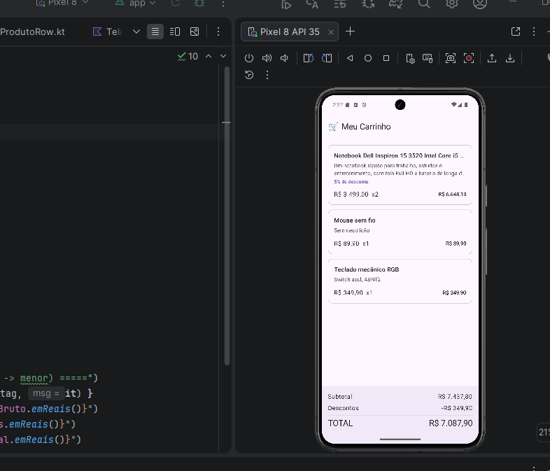
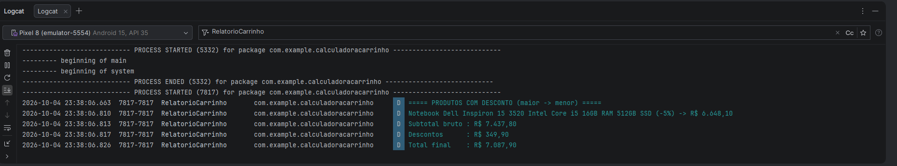

<h1 align="center">🛒 Calculadora de Carrinho de Compras</h1>

<p align="center">
  Aplicativo Android com Jetpack Compose e Material Design 3
</p>

<p align="center">
  
  
  
  
</p>

---

## 👤 Autor

**Filipe de Oliveira Lima** - DSM5

---

## 📖 Sobre o projeto

O app carrega um catálogo fixo de produtos, aplica regras de desconto por meio de funções puras, exibe o carrinho na tela com um componente reutilizável e gera um relatório formatado no Logcat.

### ✨ Funcionalidades

- Catálogo fixo com 7 produtos (com e sem desconto, com e sem descrição, com nome longo)
- Cálculo de subtotal, descontos e total final
- Lista de compras renderizada por laço de repetição a partir de um único componente
- Nomes truncados em 1 linha e descrições em 2 linhas, com reticências
- Tratamento seguro de descrição nula, exibindo "Sem descrição"
- Relatório no Logcat apenas com os produtos que receberam desconto, do maior para o menor valor
- Tipografia exclusivamente do Material Design 3

---

## 🧱 Arquitetura

```
app/src/main/java/com/example/calculadoracarrinho/
├── domain/
│   ├── Modelos.kt      # Produto, ItemCarrinho e interface Pagavel
│   └── Calculos.kt     # Funções puras de cálculo, resumo e relatório
├── data/
│   └── Catalogo.kt     # Catálogo fixo e carrinho de validação
├── ui/
│   ├── ProdutoRow.kt   # Componente reutilizável da linha do produto
│   └── TelaCarrinho.kt # Tela com cabeçalho, lista e resumo
└── MainActivity.kt     # Exibe a tela e imprime o relatório no Logcat
```

| Camada | Responsabilidade |
|---|---|
| **domain** | Modelos, contrato `Pagavel` e regras de negócio em funções puras, sem dependência do Android |
| **data** | Fonte dos dados fixos do catálogo e do carrinho |
| **ui** | Telas e componentes em Jetpack Compose, que apenas exibem o que recebem |

---

## ✅ Cenário de validação

| Produto | Preço unitário | Desconto | Quantidade |
|---|---|---|---|
| Notebook Dell Inspiron | R$ 3.499,00 | 5% | 2 |
| Mouse sem fio | R$ 89,90 | 0% | 1 |
| Teclado mecânico RGB | R$ 349,90 | 0% | 1 |

| Resumo | Valor |
|---|---|
| Subtotal bruto | R$ 7.437,80 |
| Descontos aplicados | R$ 349,90 |
| **Total final** | **R$ 7.087,90** |

---

## 📸 Capturas de tela

### Emulador

<p align="center">
  
</p>

### Logcat

<p align="center">
  
</p>

---

## 🎥 Vídeo de apresentação

(https://www.youtube.com/watch?v=j9Y5pEWA2o4)

---

<p align="center">
  Feito por Filipe de Oliveira Lima - DSM5
</p>
